# GlobeToggle



**One tap. Another language.** A small macOS menu bar app that makes Fn/🌐 switch keyboard layouts directly.

## The problem

You press Fn/🌐 to change language. Nothing happens. You press it again.

Mac users have been [reporting unreliable Fn/Globe language switching since January 2021](https://apple.stackexchange.com/questions/411715/keyboard-fn-function-key-switchusing-language) — more than five years ago.

GlobeToggle is a workaround: it detects a short Fn/Globe tap and selects the next enabled input source through the macOS API. No layout picker. No extra shortcut to remember.

## Setup

1. Build the app below, copy `dist/GlobeToggle.app` to **Applications**, and open it.
2. Enable **System Settings → Privacy & Security → Input Monitoring → GlobeToggle**, then quit and reopen the app.
3. Set **System Settings → Keyboard → Press 🌐 key to → Do Nothing**.
4. Enable at least two input sources. Briefly tap and release Fn/🌐 to switch.

Holds longer than 0.35 seconds and keyboard chords do not switch layouts. The menu includes Pause/Resume, settings, and a short guide. For automatic startup, add the app under **General → Login Items & Extensions → Open at Login**.

## Build

Apple Silicon or Intel · macOS 14+ · Apple Command Line Tools · Python 3.

```sh
bash scripts/test.command
bash build-dmg.command
```

Outputs: `dist/GlobeToggle.app` and a universal DMG. No third-party dependencies.

Locally ad-hoc signed, not notarized by Apple. After replacing a build, you may need to remove and re-add its Input Monitoring permission. Keyboard and OS restrictions can affect compatibility. See [build notes](docs/BUILDING.md).
